# TrueNAS Storage Lab: ZFS, NFS, SMB and iSCSI

A hands-on storage lab built on **TrueNAS Community Edition 25.10.7** in VMware Workstation. A single TrueNAS server exposes its disks three ways: as a Linux file share (**NFS**), as a Windows file share (**SMB**) and as a raw network disk (**iSCSI**). The iSCSI traffic is then captured and dissected with **Wireshark**.

> Mini-project for the *Storage Techniques* course, ESPRIT School of Engineering (Cloud Computing, 2026-2027).

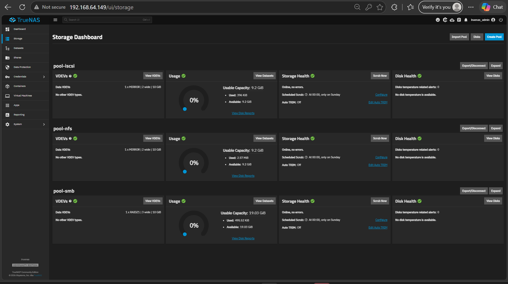

## What this lab demonstrates

- Building ZFS pools with different RAID layouts (Mirror, RAIDZ1) and comparing capacity and fault tolerance
- **File-level** storage: NFS from Ubuntu and SMB from Windows, where the server manages the file system
- **Block-level** storage: an iSCSI LUN that Windows formats as NTFS, where the server only stores blocks
- Reading an iSCSI session packet by packet: TCP handshake, login, LUN discovery, `Read(10)` and `Write(10)`
- Troubleshooting a real problem: ZFS refusing VMware disks with duplicate serial numbers

## Architecture

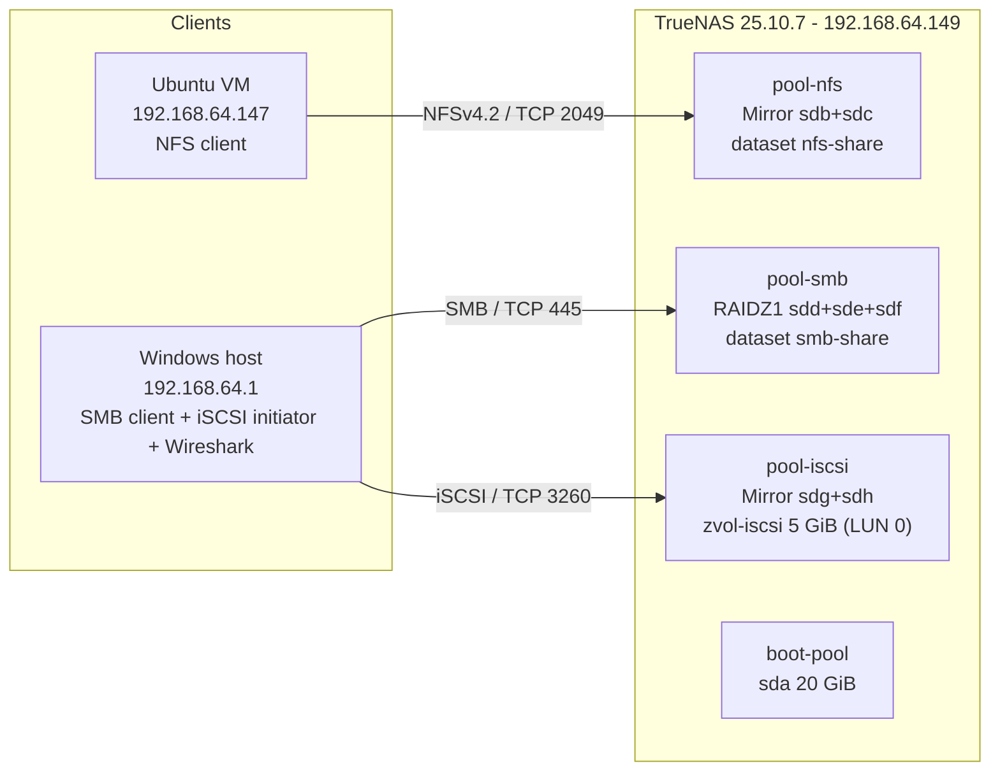

All machines sit on the VMware NAT network **VMnet8 (192.168.64.0/24)**.

## Lab environment

| Component | Details |
| --- | --- |
| Hypervisor | VMware Workstation 25H2 |
| Storage server | TrueNAS CE 25.10.7, 2 vCPU, 8 GB RAM, 1 × 20 GB boot disk + 7 × 10 GB data disks (SCSI, thin) |
| Linux client | Ubuntu 24.04 with `nfs-common` |
| Windows client | Windows 11 (File Explorer, Microsoft iSCSI Initiator, Disk Management) |
| Analysis | Wireshark 4.6.9 + Npcap 1.88 |

## Storage layout and capacity

| Pool | Disks | Layout | Theoretical usable | Usable (TrueNAS) | Fault tolerance |
| --- | --- | --- | --- | --- | --- |
| `pool-nfs` | sdb, sdc | Mirror (≈ RAID 1) | 10 GiB | 9.2 GiB | 1 disk |
| `pool-smb` | sdd, sde, sdf | RAIDZ1 (≈ RAID 5) | 20 GiB | 19.03 GiB | 1 disk |
| `pool-iscsi` | sdg, sdh | Mirror (≈ RAID 1) | 10 GiB | 9.2 GiB | 1 disk |

The ZFS hierarchy used throughout: **Disks → VDEV (RAID layout) → Pool → Dataset (files) or Zvol (blocks)**.

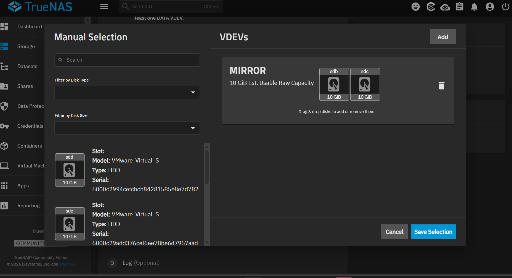

## Setup steps

### 1. TrueNAS VM

1. Create a VM with guest OS *Debian 12 64-bit*, UEFI, 8 GB RAM, NAT network, one 20 GB SCSI disk.
2. Add 7 × 10 GB SCSI disks (thin-provisioned).
3. With VMware closed, add to the `.vmx` file:
   ```
   disk.EnableUUID = "TRUE"
   firmware = "efi"
   ```
4. Install TrueNAS on the 20 GB disk only, with the `truenas_admin` account.

### 2. Pools

Creating pools in the web UI failed with `Disks have duplicate serial numbers: None`, because VMware's virtual disks report no SCSI serial. The pools were created through the TrueNAS API instead (safe here, since the disks are genuinely separate):

```bash
unset zle_bracketed_paste   # the browser shell otherwise inserts ^[[200~ around pasted text

sudo midclt call -j pool.create '{"name": "pool-nfs",   "topology": {"data": [{"type": "MIRROR", "disks": ["sdb", "sdc"]}]},        "allow_duplicate_serials": true}'
sudo midclt call -j pool.create '{"name": "pool-smb",   "topology": {"data": [{"type": "RAIDZ1", "disks": ["sdd", "sde", "sdf"]}]}, "allow_duplicate_serials": true}'
sudo midclt call -j pool.create '{"name": "pool-iscsi", "topology": {"data": [{"type": "MIRROR", "disks": ["sdg", "sdh"]}]},        "allow_duplicate_serials": true}'
```

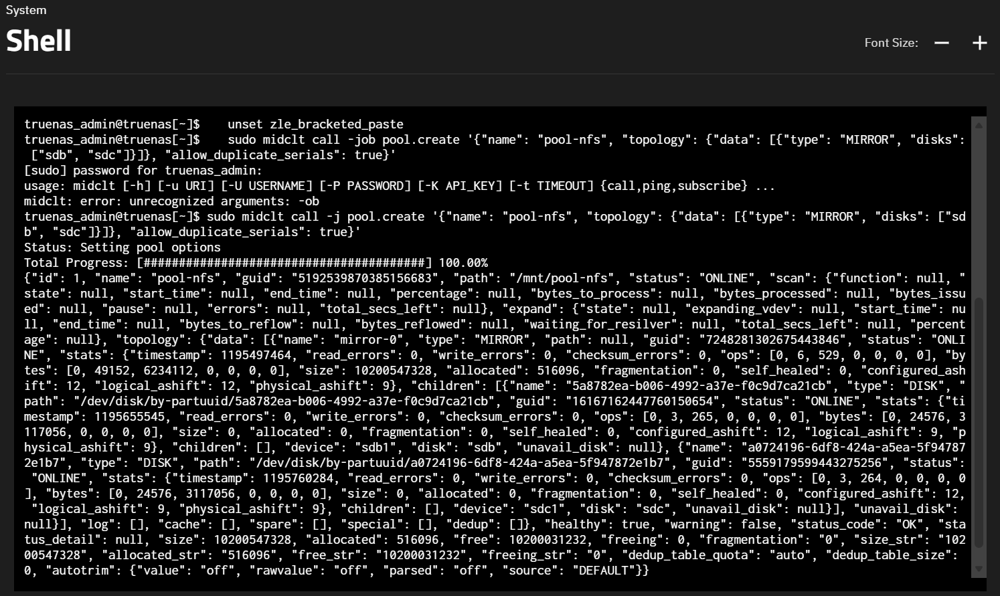

### 3. NFS (Linux client)

- Dataset `pool-nfs/nfs-share` (preset *Generic*)
- NFS share restricted to `192.168.64.0/24`, *Mapall* user/group `root`

```bash
sudo apt install -y nfs-common
showmount -e 192.168.64.149
sudo mkdir -p /mnt/nfs
sudo mount -t nfs 192.168.64.149:/mnt/pool-nfs/nfs-share /mnt/nfs
mount | grep nfs   # type nfs4, vers=4.2, proto=tcp, sec=sys
```

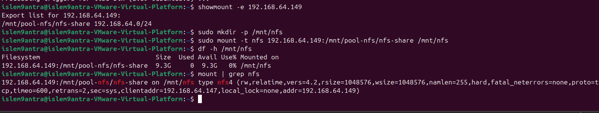

Files created on Ubuntu appear on the server at their real path:

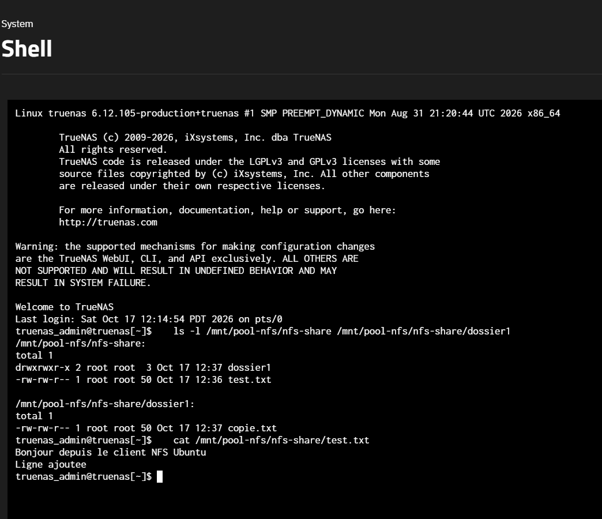

### 4. SMB (Windows client)

- User `smbuser` with **SMB access only** (no shell, SSH or admin access)
- Dataset `pool-smb/smb-share` with preset *SMB* (case-insensitive, NFSv4 ACLs)
- Access from Windows Explorer: `\\192.168.64.149\smb-share`

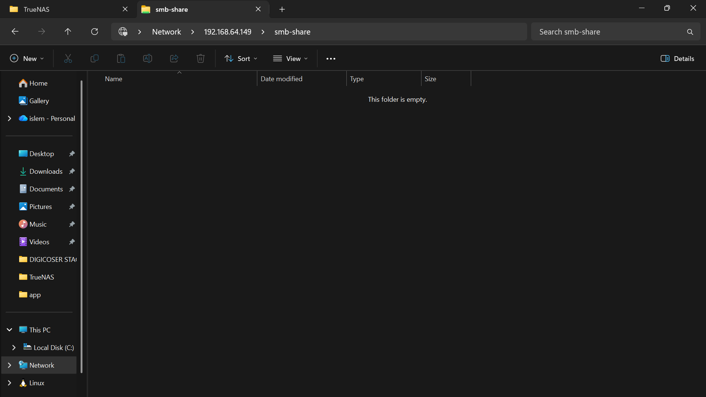

On the server, files are owned by the authenticated user `smbuser`:

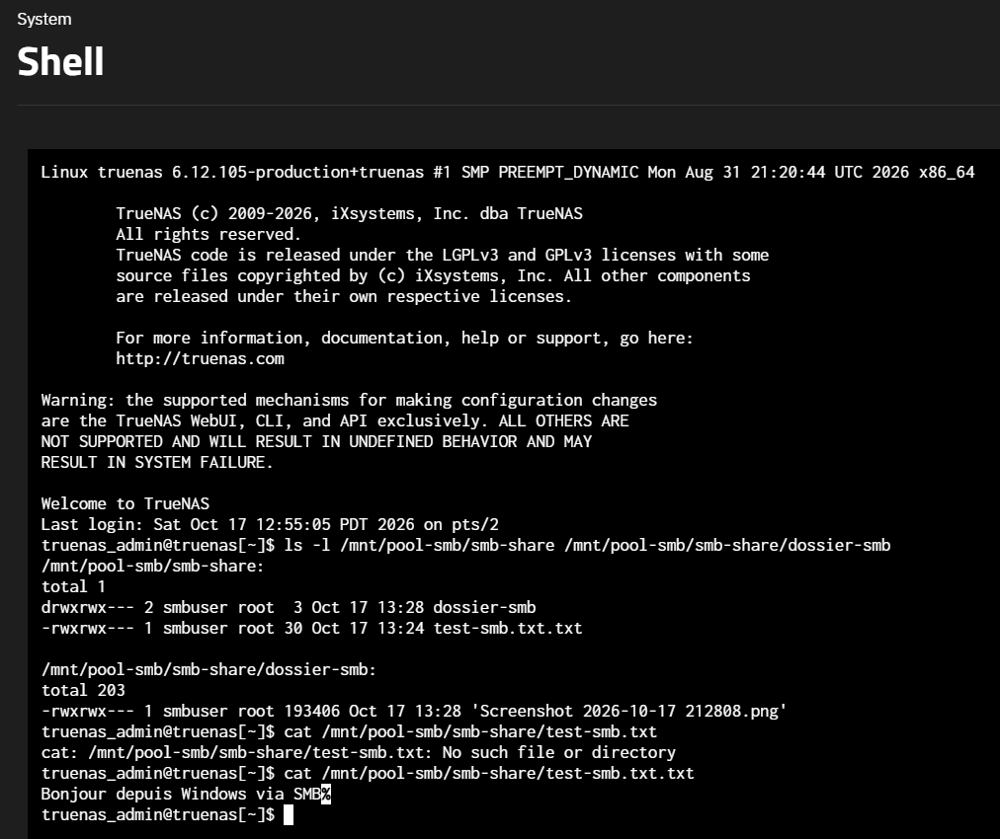

### 5. iSCSI (Windows initiator)

- Zvol `pool-iscsi/zvol-iscsi`, 5 GiB, thick-provisioned
- iSCSI wizard: extent of type *Device*, platform *Modern OS* (4 KiB blocks), portal `0.0.0.0:3260`
- Target IQN: `iqn.2005-10.org.freenas.ctl:iscsi-target`, exposed as **LUN 0**
- Windows: iSCSI Initiator → Quick Connect `192.168.64.149` → Disk Management → GPT → NTFS → drive `I:`

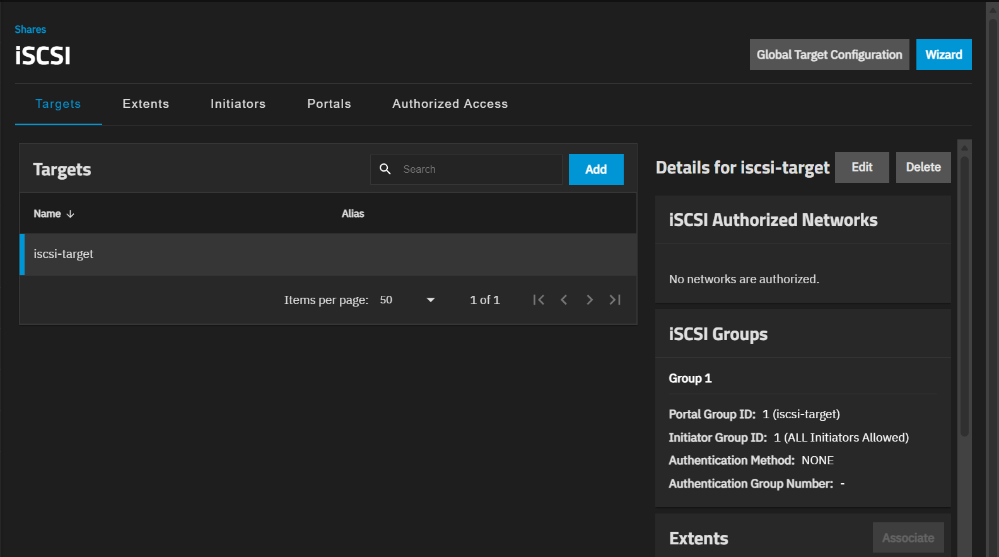

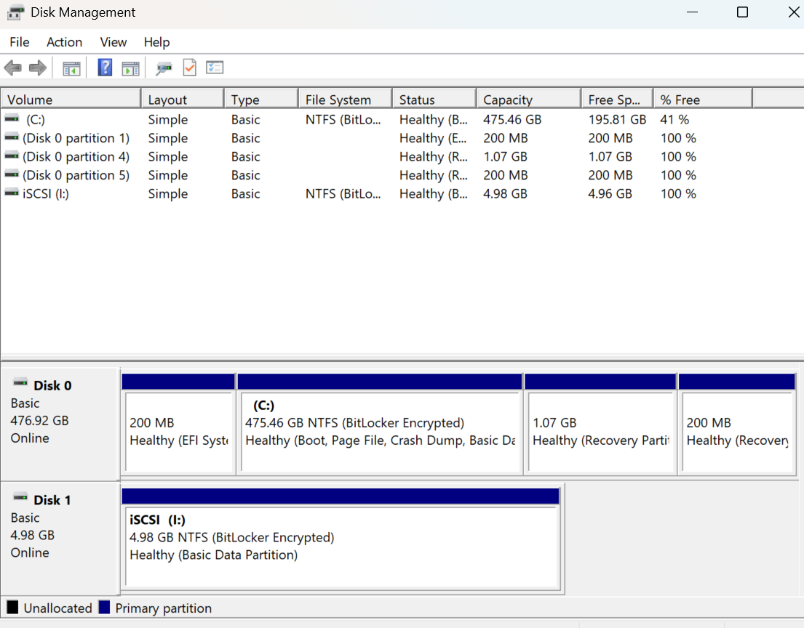

**The block-level proof:** Windows sees files on `I:`, but TrueNAS sees no files at all, only a block device:

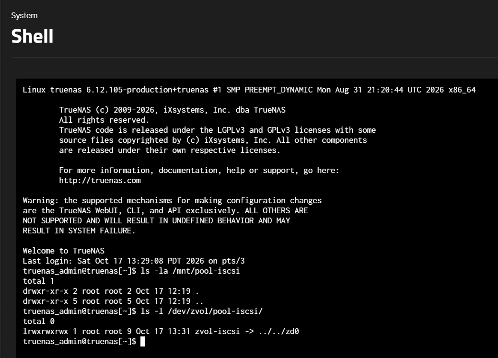

## Wireshark analysis

Capture on *VMware Network Adapter VMnet8* with capture filter `tcp port 3260`.

| Display filter | What it shows |
| --- | --- |
| `iscsi` | All iSCSI PDUs: NOP keep-alives, Logout, Login, SCSI commands |
| `tcp.port == 3260 && tcp.flags.syn == 1` | TCP handshake to port 3260 |
| `iscsi.opcode == 0x03 \|\| iscsi.opcode == 0x23` | Login Command / Login Response |
| `scsi_sbc.opcode == 0x28` | SCSI `Read(10)` |
| `scsi_sbc.opcode == 0x2a` | SCSI `Write(10)` |

Session observed:

1. **TCP:** `[SYN]` 51510 → 3260, `[SYN, ACK]`, `[ACK]` (MSS 1460)
2. **Login:** security negotiation (`AuthMethod=None`), then operational negotiation → *Full Feature Phase*
3. **Discovery:** `Report LUNs` → LUN 0, `Read Capacity(10)` → 5.00 GiB
4. **I/O:** `Read(10)` 4,096 bytes → `Data In (Good)`; `Write(10)` 20,480 bytes in 15 TCP segments → `SCSI Response (Good)`

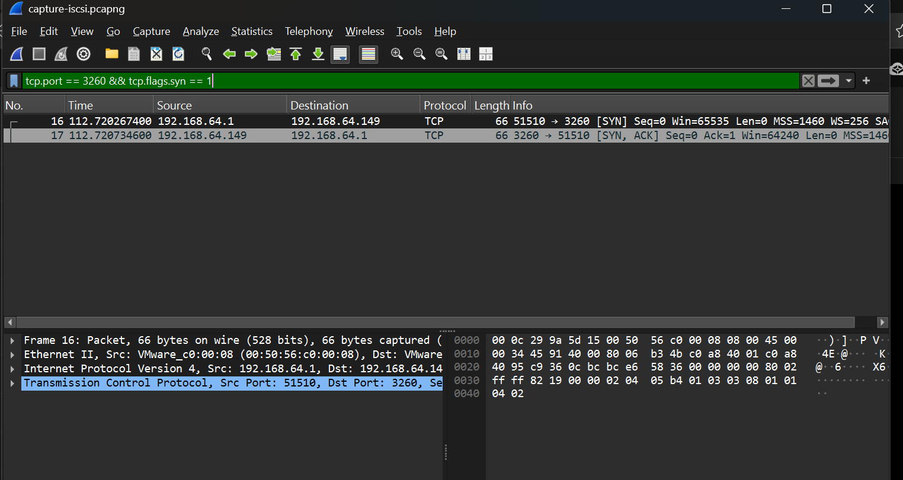

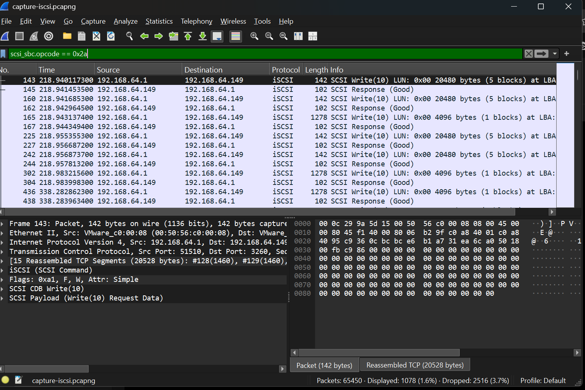

### Encapsulation

```
SCSI       CDB Write(10): opcode 0x2A, LBA, block count + data
  ↓
iSCSI      PDU "SCSI Command": 48-byte header (LUN, flags F/W, task tag)
  ↓
TCP        51510 → 3260, segments of up to 1460 bytes
  ↓
IP         192.168.64.1 → 192.168.64.149
  ↓
Ethernet   Windows VMnet8 adapter MAC → TrueNAS MAC
```

## NFS vs SMB vs iSCSI

| | NFS | SMB | iSCSI |
| --- | --- | --- | --- |
| Storage type | File-level | File-level | Block-level |
| Port | TCP 2049 | TCP 445 | TCP 3260 |
| File system managed by | Server (ZFS) | Server (ZFS via Samba) | Client (NTFS) |
| Appears on client as | Mounted directory | Network folder | Local disk |
| Server can see files | Yes | Yes | No |
| Typical use | Linux shares, containers | Office file shares | VM disks, databases |

## Problems solved

| Problem | Fix |
| --- | --- |
| VM created inside OneDrive (would sync GBs of disk files) | Moved to `C:\VMs` |
| `Disks have duplicate serial numbers: None` | Pools created with `midclt ... "allow_duplicate_serials": true` |
| `zsh: bad pattern: ^[[200~` when pasting in the web shell | `unset zle_bracketed_paste` |
| `midclt: unrecognized arguments: -ob` | The job flag is `-j`, not `-job` |
| First capture missed the iSCSI login | Start Wireshark first, then disconnect/reconnect the target |

## Possible improvements

- HTTPS for the web UI, CHAP on the iSCSI target, initiator restriction by IQN
- Kerberos (`sec=krb5`) or matching UIDs instead of NFS Mapall
- A dedicated storage VLAN, RAIDZ2 or hot spares, scheduled scrubs and snapshots

## Full report

The complete report, with every step, all 62 screenshots and the answers to the synthesis questions, is in [`report/`](report/).

---

*Author: Islem Azzouz — Cloud Computing engineering student, ESPRIT*
